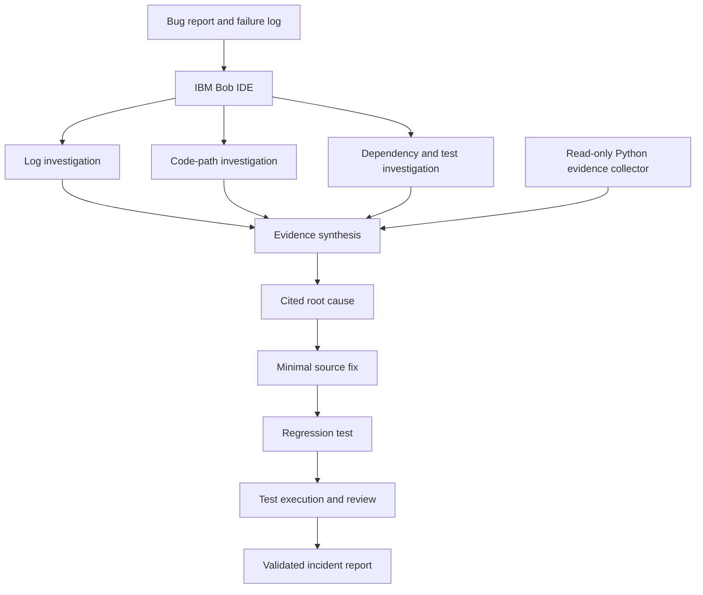

# Architecture

Bob owns the reasoning loop, repository changes, regression-test creation, and validation. The Python collector is deterministic support: it scans bounded local inputs concurrently and provides evidence that Bob can compare with its own investigation.
